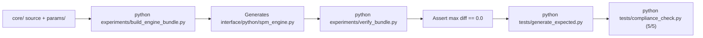

# SPM Rating v1.1.0 Maintenance and Operation Guide

> This manual is intended for engineers using, maintaining, and developing SPM Rating.
> It covers environment setup, rating APIs, regression compliance checks, release packaging pipelines, and critical development guardrails.
> Companion docs: [Mechanism Specification](mechanism.md), [History & Findings](history.md).

---

## 1. Environment & Dependencies

Recommended runtime: **Python 3.10 or newer**. Production deployment requires only two scientific packages:

```bash
pip install -r requirements.txt
```

`requirements.txt`:
```
numpy>=1.23.0
scipy>=1.9.0
```

For test suites and development:
```bash
pip install -r requirements-dev.txt
```

All commands assume the repository root as the working directory.

---

## 2. Day-to-Day Rating & Public API

### 2.1 Python API Usage
The public API resides in `interface/spm_interface.py` (and the bundled single-file engine `interface/python/spm_engine.py`):

```python
import sys
sys.path.insert(0, "interface/python")
import spm_interface as spm

# Method 1: Specify a .osu file path
res = spm.analyze("path/to/chart.osu", input_type="path")
if res["star"] > 0:
    print(f"Star Rating: {res['star']:.3f}")
else:
    print(f"Rating Failed: {res.get('error')}")

# Method 2: Pass raw chart text
with open("path/to/chart.osu", encoding="utf-8") as f:
    text = f.read()
res = spm.analyze(text, input_type="content")
print(f"Star Rating: {res['star']:.3f}")
```

### 2.2 Output Modes & Contract
Supports `minimal` (default) and `full` modes per `interface/manifest.json`:
- `minimal`: Returns `{"schema_version": "1.1", "star": float, "error": str | None}`;
- `full`: Returns full dictionary containing `algorithm`, `star`, `star_rc`, `star_ln`, `sort`, `tags`, `curves`, `performance`, `extras`. Unimplemented sub-metrics return sentinel `-255` or `None`.

---

## 3. Regression Testing & Compliance Checks

Both test suites must pass 100% before any release:

### 3.1 Interface Compliance Check (5/5 PASS)
```bash
python tests/compliance_check.py
```
Performs 5 automated safety checks:
1. **(a) Isolated directory run**: Copies `interface/python/` into an isolated temporary folder and confirms the engine runs without repository dependencies;
2. **(b) Full schema & sentinel check**: Confirms full-mode key sets match contract and missing fields carry sentinels;
3. **(c) Manifest capability alignment**: Verifies runtime `capabilities()` match `interface/manifest.json`;
4. **(d) Golden regression test**: Recomputes all 10 built-in test charts in `tests/cases/` and verifies outputs match `tests/expected.json` within tolerance 0.001;
5. **(e) Corrupted input handling**: Confirms corrupted or non-existent files return error dictionaries without unhandled crashes.

### 3.2 Unit Tests & Parameter Sync Guard (13/13 PASS)
```bash
python -m pytest tests/ -q
```
- Validates `test_lncoord_v2.py` coordination cost mechanics;
- Runs `test_params_sync.py`: **Critical guard**, asserting that the 272 parameters and documentation notes embedded inside `interface/python/spm_engine.py` match `params/spm-rating-1.1.0.json` bit-for-bit.

---

## 4. Release & Engine Bundling Pipeline

When modifying `core/` or parameters, the standalone single-file engine must be re-assembled and verified via the automated pipeline:



1. **Rebundle Standalone Engine**:
   ```powershell
   python experiments/build_engine_bundle.py
   ```
2. **Strict Numerical Verification (Zero Error Guard)**:
   ```powershell
   python experiments/verify_bundle.py
   ```
   Compares standalone engine outputs against multi-file `core/` across test charts; **must satisfy `max |diff| = 0.0`**.
3. **Regenerate Expected Scores & Run Compliance**:
   ```powershell
   python tests/generate_expected.py
   python tests/compliance_check.py
   python -m pytest tests/ -q
   ```
4. **Update Version**:
   Update `version` in `spm_version.json`.

---

## 5. Engineering Guardrails & Pitfalls

### 5.1 Unit Confusion Trap (Most Lethal)
- `b.t`, `s.t`, `s.dt_ms`, `s.dt_diff`: Units are strictly in **milliseconds (ms)**;
- `s.dt`, `s.duration`: Units are in **seconds (s)**;
- Mixing them distorts channel scales by hundreds of times and disguises bugs as fake improvements.

### 5.2 Xbar is a Dead Channel in Chords
- Candidate `t_jack_mix = -0.3555` makes the twist numerator negative in chord/jack regions;
- $D = d_{b2} \cdot S$ has zero gradient with respect to Xbar. **Any chord-related hand constraints must route through the stream branch ($d_{\mathrm{hc}} \cdot \mathrm{HCd}$), never Xbar**.

### 5.3 6K Zero-Shot Read-Only Rule
- 6K labels are coarse half-steps with a $\pm 0.002$ noise floor;
- **Never tune parameters against 6K**, as it destroys its role as an honest zero-shot generalization test.

### 5.4 Respect Locked Decisions
- Mode 4 two-level sectioned mass aggregation is locked; do not revert to wall-clock time weighting or ungrounded sigmoid curves.
