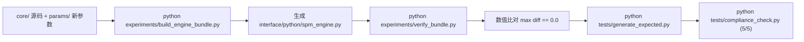

# SPM Rating v1.1.1 维护与升级手册

> 本手册面向使用、维护与升级 SPM Rating 算法的工程师。
> 涵盖环境搭建、日常评分接口调用、合规回归检查、发版打包流水线，以及必须严格遵守的工程避坑铁律。
> 配套文档：[《机制说明》](mechanism.zh-CN.md) 详细阐述算法内部公式，[《研制历程与结论》](history.zh-CN.md) 记录实验依据。

---

## 1. 环境与依赖

运行环境为 **Python 3.10 及以上版本**。生产部署仅依赖两个科学计算库：

```bash
pip install -r requirements.txt
```

`requirements.txt` 内容：
```
numpy>=1.23.0
scipy>=1.9.0
```

若需执行完整单元测试与代码风格检查，安装开发依赖：
```bash
pip install -r requirements-dev.txt
```

所有工程命令均以仓库根目录为当前工作目录。

---

## 2. 日常评分与对外接口

### 2.1 Python API 调用
对外公开接口位于 `interface/spm_interface.py`（以及底层单文件自包含引擎 `interface/python/spm_engine.py`）：

```python
import sys
sys.path.insert(0, "interface/python")
import spm_interface as spm

# 方式一：直接指定 .osu 谱面路径
res = spm.analyze("path/to/chart.osu", input_type="path")
if res["star"] > 0:
    print(f"Star Rating: {res['star']:.3f}")
else:
    print(f"Rating Failed: {res.get('error')}")

# 方式二：传入谱面文本字符串
with open("path/to/chart.osu", encoding="utf-8") as f:
    text = f.read()
res = spm.analyze(text, input_type="content")
print(f"Star Rating: {res['star']:.3f}")
```

### 2.2 接口字段与模式规范
接口支持 `minimal`（默认）与 `full` 模式，详见 `interface/manifest.json`：
- `minimal`：返回 `{"schema_version": "1.1", "star": float, "error": str | None}`；
- `full`：返回包含 `algorithm`, `star`, `star_rc`, `star_ln`, `sort`, `tags`, `curves`, `performance`, `extras` 的全量字典。未计算的细分维度以哨兵值 `-255` 或 `None` 返回。

---

## 3. 回归测试与合规检查

发布前必须确保以下两项测试 100% 通过：

### 3.1 接口合规性检查（5/5 PASS）
```bash
python tests/compliance_check.py
```
该脚本执行以下 5 项自动化安全防御检查：
1. **(a) 独立目录隔离运行**：将 `interface/python/` 复制到临时沙箱，验证单文件引擎无需仓库根目录即可独立运行；
2. **(b) 全量字段与哨兵守卫**：验证 `full` 模式键集合严格吻合且未实现字段准确赋哨兵值；
3. **(c) 契约一致性**：验证动态 `capabilities()` 与 `interface/manifest.json` 静态声明完全对齐；
4. **(d) 内置回归谱面数值守护**：重新计算 `tests/cases/` 下 10 张内置谱面，验证与 `tests/expected.json` 预期星数差异在容差 0.001 内；
5. **(e) 异常输入防御**：输入损毁谱面或不存在路径时，返回标准错误字典，严禁崩溃抛出未捕获异常。

### 3.2 单元测试与参数同步守卫（13/13 PASS）
```bash
python -m pytest tests/ -q
```
- 验证 `test_lncoord_v2.py` 长键协调跨列代价计算正确性；
- 验证 `test_params_sync.py`：**核心安全守卫**，确保 `interface/python/spm_engine.py` 内部固化的参数与 `params/spm-rating-1.1.1.json` 发布的 276 个参数键名、数值及备注文本**绝对一致 (Bit-for-Bit)**。

---

## 4. 发版与引擎打包流水线

当算法核心 `core/` 或参数发生变更时，严禁手动复制粘贴单文件引擎，必须通过标准流水线重新编译与验证：



1. **重新组装自包含单文件引擎**：
   ```powershell
   python experiments/build_engine_bundle.py
   ```
2. **严格数值验证（零误差守卫）**：
   ```powershell
   python experiments/verify_bundle.py
   ```
   比对单文件引擎与多文件 `core/` 源码在批量测试谱面上的输出差值，**必须满足 `max |diff| = 0.0`**。
3. **更新测试预期并合规校验**：
   ```powershell
   python tests/generate_expected.py
   python tests/compliance_check.py
   python -m pytest tests/ -q
   ```
4. **版本号同步**：
   同步更新 `spm_version.json` 中的 `version` 字段。

---

## 5. 调优开发铁律与避坑指南

若后续版本需对机制进行探索或重新调优，必须牢记前任工程师积累的血泪教训：

### 5.1 单位量纲陷阱（最致命）
- `b.t` / `s.t` / `s.dt_ms` / `s.dt_diff`：单位是**毫秒 (ms)**；
- `s.dt` / `s.duration`：单位是**秒 (s)**；
- **禁止混用**：混用会将某条通道无意放大或缩小数百倍，伪装成"假性改善"。

### 5.2 Xbar 是和弦区的死通道
- 当前最佳参数的 `t_jack_mix = -0.3555`，导致扭曲分子 $Xt = \mathrm{Xbar} + t_{\mathrm{jm}} \cdot Jm$ 在和弦/连打区变为负值；
- 瞬时难度 $D = d_{b2} \cdot S$ 完全感知不到 Xbar 的变化。**任何与和弦相关的同手牵制或间距阻力，必须走流分支（如 $d_{\mathrm{hc}} \cdot \mathrm{HCd}$ ），严禁寄托于 Xbar**。

### 5.3 6K 零样本只读铁律
- 6K 数据集仅用于监控机制泛化。其社区标签颗粒度极粗，噪声边界在 $\pm 0.002$ 左右；
- **绝对禁止在 6K 上反向调参**，否则会破坏其作为诚实泛化测试域的价值，且极易过拟合粗糙标签。

### 5.4 区分曲线参数与非曲线参数
- **曲线参数（慢，触发 compute_curves 重算）**：`mj_dilute`, `ga_*`, `c_fj`, `hc_e`, `d_hc`, `w_tech` 等，建议网格扫描；
- **非曲线参数（极快，仅影响 combine/aggregate）**：`c_jm`, `c_jc`, `c_s`, `s_p`, `aggC_*`, `calib_*` 等，可使用 Nelder-Mead (NM) 快速拟合。

### 5.5 已锁定的核心决策不可推翻
- 聚合模式严格锁定为 **mode 4**（两级物量聚合），禁止重试已证伪的 sigmoid 准度二分或疲劳核残差。
