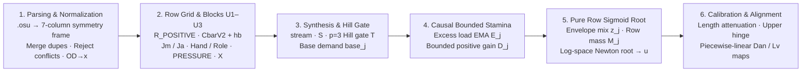

# SPM Rating v1.3.0 Algorithm Mechanism Specification

[简体中文](mechanism.zh-CN.md) · [Model Overview](model.md) · [Evaluation](evaluation.md) · [4K Calibration](calibration-4k.md) · [Time Handling](time.md) · [Usage](../README.md)

---

This specification provides the complete mathematical formulation, physical motivation, structural constraints, and frozen parameter reference for SPM Rating **v1.3.0**, covering both production profiles: **`detail` (`V13-D1`, 78 fitted continuous parameters)** and **`compact` (`V13-C`, 70 fitted continuous parameters)**. Textual values are rounded to three or four significant digits for clarity; full double-precision constants live in [detail.json](../spm_rating/models/detail.json) and [compact.json](../spm_rating/models/compact.json).

---

## §1 Design Goals and Computation Pipeline

Built on the sunny-rework seven-column coordinate representation, SPM Rating v1.3.0 addresses four structural challenges in multi-key VSRG (osu!mania 4K / 6K / 7K) difficulty modeling:

1. **Physical monotonicity and bounded extrapolation**: Eliminate synthetic monotonicity inversions and severe out-of-distribution (OOD) leverage explosions caused by signed channel cancellations, unbounded subtractive recovery, and unconstrained chord tables—reducing violations across 91 synthetic physical control checks from `120` in `v1.2.0-rc3` to **`0`**.
2. **Continuous split-chord handling and zero phase jump**: Preserve smoothness under `±1 ms` timing jitter and replace rigid sliding-window two-level power means with row-level aggregation, reducing aggregation-origin phase spread strictly to **`0.0`**.
3. **Key-resolved long-note coordination**: Replace coarse global hold counts with native row-grid cross-column locking matrices (`CbarV2`) and positive release urgency (`R_POSITIVE`) to distinguish same-hand adjacent locks, interior-finger straddles, cross-hand holds, partial LN overlaps, and shield taps before holds.
4. **Local–global consistency and cross-game generalization**: Replace window quantiles with engagement-mass-weighted Log-Logistic Row Sigmoid root finding, improving local 1–2 second error prediction and external BMS table ordering without distorting full-chart rankings.

The scoring pipeline executes in six stages:

Both production profiles execute [v130_rev2.py](../spm_rating/v130_rev2.py):

- **`detail` (`V13-D1`)**: Fits **78** continuous parameters. It runs the nonlinear `forward()` pass on both the canonical orientation and its horizontal mirror and averages the resulting difficulty fields post-forward, guaranteeing exact `0.0` mirror asymmetry.
- **`compact` (`V13-C`)**: Fits **70** continuous parameters in a single pass on lexicographically canonicalized notes (~`0.49×` runtime of `detail`), omitting `lockanchor` and `shield` from `CbarV2` while holding six secondary shape/hinge parameters (`ga_shape`, `role_price`, `stam_theta`, `stam_half`, `pp_thr`, `pp_div`) at fixed validated defaults.
- **`detail-4k`**: Reuses the exact `detail` native scorer verbatim while binding the v1.3.0 monotone piecewise-linear 4K Dan reference map through a signed identity overlay (see [4K reference calibration](calibration-4k.md)).

---

## §2 Coordinate Representation and Common Operators

### 2.1 Symmetric Seven-Column Embedding and Finger Anatomy

All supported key counts ($K_{\text{orig}} \in \{4, 6, 7\}$) map into a fixed seven-lane frame so physical finger gaps, same-hand adjacency, and cross-hand transitions share one unified geometry:

| Original Key Count | Original Columns | Embedded 7-Column Indices | Empty Tracks |
|---|---|---|---|
| **4K** | `0, 1, 2, 3` | **`1, 2, 4, 5`** | `0, 3, 6` |
| **6K** | `0, 1, 2, 3, 4, 5` | **`0, 1, 2, 4, 5, 6`** | `3` |
| **7K** | `0, 1, 2, 3, 4, 5, 6` | **`0, 1, 2, 3, 4, 5, 6`** | — |

Fixed anatomical partitions on tracks `0..6`:

- **Hand partition `HAND`**: tracks `0, 1, 2` belong to the left hand (`0`), track `3` is the center thumb track (`1`), and tracks `4, 5, 6` belong to the right hand (`2`).
- **Finger symmetry `AIN_GROUP`**: ring (`0, 6 → 0`), middle (`1, 5 → 1`), index (`2, 4 → 2`), and thumb (`3 → 3`).
- **Boundary groups `BOUND_GROUP`**: eight transition chains `0..7` (left edge `0` on lane `0`, right edge `7` on lane `6`, interior boundaries `1..6` merging adjacent pairs `(k-1, k)`) share mirror-symmetric weights via `[0, 1, 2, 3, 3, 2, 1, 0]`.

Parsing and structural preparation enforce three invariants:
1. **Canonical deduplication**: Exact duplicate objects at the same timestamp and physical key are merged; simultaneous objects on the same column with conflicting tail times raise `ValueError`.
2. **Speed-rate OD conversion**: A speed rate $r > 0$ linearly interpolates osu!mania 300g hit windows (`22.0 / 19.5 / 16.0 ms` at `OD 0 / 5 / 10`) to compute effective $\mathrm{OD}_{\text{eff}}$ satisfying $w(\mathrm{OD}_{\text{eff}}) = w(\mathrm{OD}) / r$.
3. **Pure sustained single-row fallback**: If a chart or sliced segment collapses to a single head timestamp carrying held long notes (`span > 0`), a virtual support row is placed at $t_0 + 0.5\cdot\mathrm{span}$ with held count `H_sup` so demand remains well-defined.

### 2.2 Hit Leniency and Row-Grid Windowing

Overall Difficulty enters solely through the physical timing leniency scale $x$ (seconds):

$$
q = \frac{64.5 - \lceil 3\,\mathrm{OD}_{\text{eff}} \rceil}{500}, \qquad
x_0 = 0.3\sqrt{\max(q,\, 10^{-6})}, \qquad
x = \min\!\big(x_0,\; 0.6(x_0 - 0.09) + 0.09\big).
$$

Across $\mathrm{OD} \in [0, 10]$, $x$ decreases monotonically from `0.1007` s to `0.0788` s. Individual channels raise $x$ to separate sensitivity exponents $m_f$ ($x_f = x^{m_f}$):

| Channel | Parameter | Value $m_f$ | Role |
|---|---|---:|---|
| Jack `Jm / Ja` | `od_mult_jm` | `1.204` | Tightens repeated-hit timing tolerance |
| Density `P` | `od_mult_p` | `1.129` | Increases high-rate stream precision demand |
| Crossing `X` | `od_mult_x` | `1.197` | Amplifies rapid transition accuracy cost |
| Release `R` | `od_mult_r` | `1.059` | Increases tail-release timing sensitivity |

All curves live on the sorted deduplicated timestamp grid $\{t_0 < t_1 < \dots < t_{n-1}\}$, with inter-row gaps $\Delta t_j = t_{j+1} - t_j$ (ms) and $d_j = \Delta t_j / 1000$ (s). Two shared continuous operators recur throughout:

- **Centered step-function mean $\bar{v}_W(t_j)$**: Integrates the right-continuous step function $v(t)$ over a centered window of nominal width $W$ ms (clamped at chart boundaries):

$$
\bar{v}_W(t_j) = \frac{1}{W}\int_{\max(t_0,\, t_j - W/2)}^{\min(t_{n-1},\, t_j + W/2)} v(t)\,\mathrm{d}t.
$$

- **Triangular chord coupling & hand gesture sizes**: With $\tau_c = 24.346\text{ ms}$ (`chord_tau_c`), define kernel $K(\Delta) = \mathrm{clip}(1 - \Delta / \tau_c,\, 0,\, 1)$:
  - Backward attack weight $\mathrm{att}_r = 1 - K(t_r - t_{r-1})$ suppresses duplicate attack counts when a chord splits across near-simultaneous rows;
  - Left/right hand gesture counts weight neighboring hits continuously per hand (`{0,1,2,3}` vs `{4,5,6}`):
    $$
    u_L(r) = \sum_{r'} \mathrm{left\_bits}(r')\, K(|t_{r'}-t_r|), \qquad
    u_R(r) = \sum_{r'} \mathrm{right\_bits}(r')\, K(|t_{r'}-t_r|).
    $$

---

## §3 Elementary Physical Demand Channels

Upstream extraction is grouped into three blocks (`U1`: positive release, `U2`: `CbarV2` coordination atoms, `U3`: jack/hand/role/pressure/crossing/irregularity) evaluated jointly with downstream parameters.

### 3.1 Jack, Anchor, Shared Hand Work, and Finger Role (`Jm`, `Ja`, 4K Triple, `hand`, `role`)

#### (1) Per-Column Jack Kernels and Cross-Lane Power Mean

For each track $k \in \{0,\dots,6\}$ with consecutive same-column interval $g$ (seconds, floored at $10^{-4}\text{ s}$), the instantaneous jack kernel is:

$$
\mathrm{kern}_k(g, x) = \frac{1}{g \cdot \big(g + j_{c1}\, x_k^{1/4}\big)}, \qquad j_{c1} = 0.1613,\quad x_k = x^{m_{jm}}.
$$

v1.3.0 **eliminates legacy negative jack dips (`j_nerf_a = 0`)** and **chord dilution**, keeping jack response strictly monotone. Each column curve is centered-smoothed over `w_jm` (`878.6 ms`) and aggregated across active columns weighted by smoothed local rate $\bar{w}_k = \bar{v}_{w_{jm}}(1/g_k)$ using a power mean of order $j_{\mathrm{pow}} = 2.805$:

$$
J(t) = \left( \frac{\sum_{k=0}^6 \bar{w}_k(t)\, \big[\bar{v}_{w_{jm}}(C_k)(t)\big]^{j_{\mathrm{pow}}}}{\sum_{k=0}^6 \bar{w}_k(t) + \epsilon} \right)^{1/j_{\mathrm{pow}}}.
$$

From this core, the engine extracts:
- **4K triple-jack positive increment**: Three consecutive hits on one lane spanning $\Delta_3 < 2 h_3$ ($h_3 = 141.0\text{ ms}$) activate $\tau_3 = \max(0,\, 1 - \Delta_3 / (2 h_3))$; on **4K charts only**, the strictly nonnegative excess $\max(J_{\mathrm{trip}} - J_m,\, 0)$ is added with weight `j_triple_4k` (`detail 0.2552 / compact 0.8626`).
- **Anchor channel `Ja`**: Modulates the same kernel by $\left(\frac{e}{e + 4.913}\right)^{0.874}\left(1 + \frac{\mathrm{other}}{n_{\mathrm{rows}}}\right)^{0.0126}$, where $e = \max(\mathrm{runlen}+1, 0)$ tracks consecutive intervals $\le 251.0\text{ ms}$.
- **Fast-jack bonus `FJ`**: Adds smoothed $g^{-1}(1 - g/0.15)$ for ultra-short jacks below `150 ms` scaled by `1.291` (7K/6K) or `1.189` (4K).

#### (2) Shared Hand Repeat-Contact Cost (`hand.py` & `hand_cost.py`)

`hand.py` distinguishes isolated single-finger jacks from shared multi-finger repeat work on the same hand across two thumb assignments ($\pi_0 = [0,0,0,0,1,1,1]$, $\pi_1 = [0,0,0,1,1,1,1]$, scale $\tau = 30\text{ ms}$):

1. Using the quintic smoothstep $S_5(u) = u^3(10 - 15u + 6u^2)$ on $u \in [0, 1]$, each same-column repeat receives eligibility $e_j = S_5(\Delta t_{\text{lane},j}/\tau)\big(1 - S_5(c_j)\big)$, where $c_j$ accumulates intervening same-hand hits.
2. Normalizing coactivation moments against an exact maximum-pulse hull yields bounded per-contact hand mass $m_j^{\mathrm{hand}} \in [0, e_j]$. Spreading weights via compact cosine-squared pulses (`actions.py`) produces hand rates $H_h(t)$ and per-hand independent-finger upper bounds $I_h(t) = \max_{k \in h} L_k(t)$.
3. Scoring the unexplained excess with Sunny rate cost $f(r) = r^2 / (1 + k r)$ ($k = j_{c1} x_{jm}^{1/4}$):

$$
\mathrm{extra\_hand}(t) = \sqrt{\frac{1}{2}\sum_{\pi \in \{\pi_0,\pi_1\}} \max_{h \in \{L, R\}} f\Big(\max\big(H_h^{(\pi)}(t) - I_h^{(\pi)}(t),\, 0\big)\Big)^2}.
$$

#### (3) Post-Occupation Finger Role Burden (`role.py`)

A finger pressed immediately after sustained long-note duty incurs extra workload. After merging overlapping holds per track, `role.py` evaluates trailing window occupation duty $d_i \in [0, 1]$ over `w_jm` and nearest same-lane interval $g_i \ge 10^{-4}\text{ s}$, dispersing convex budget $w_i^{\mathrm{role}} = d_i^2 / (g_i + k)$ with unit-integral $\cos^2$ pulses of half-width $W/2$:

$$
d_{\mathrm{role}}(q) = \max_{k \in \{0,\dots,6\}} \sum_{i:\,\mathrm{col}_i=k,\, |\Delta t| < W/2} w_i^{\mathrm{role}} \cdot \frac{2000}{W}\cos^2\!\left(\frac{\pi \Delta t}{W}\right).
$$

Crucially, **jack context $J_{b,\mathrm{ctx}}$ used by the Hill gate excludes hand and role surcharges**, whereas **movement workload $J_b$ includes both**:

$$
J_{\mathrm{in}} = \max\!\big(J_{m,\mathrm{raw}} + \mathrm{extra\_hand} + \text{role\_price}\cdot d_{\mathrm{role}},\, 0\big), \qquad
J_b = A^{\frac{a_j}{K_s}} \min\!\big(J_{\mathrm{in}},\, \mathrm{cap}_a + \mathrm{cap}_b J_{\mathrm{in}}\big),
$$

with `cap_a = 22.111, cap_b = 0.5877`.

---

### 3.2 Density, Hand-Structured Chord Pricing, and Burst (`PRESSURE` & `hc`)

#### (1) Rate Tolerance and Long-Note Body Density

With $d_{\mathrm{fp}}$ denoting time to the next non-coupled attack and $x_p = x^{m_p}$:

$$
q = \min\!\left(d_{\mathrm{fp}} - \frac{x_p}{2},\; \frac{x_p}{6}\right), \qquad
f_p = \left[\max\!\left(\frac{p_{\mathrm{scale}}}{x_p}\left(1 - \frac{p_{\lambda 3}}{x_p} q^2\right),\, 0\right)\right]^{1/4},
$$

$$
v = 1 + p_{\lambda 2}\, \frac{\mathrm{held}\cdot \Delta t_{\mathrm{ms}}}{\max(\Delta t_{\mathrm{ms}}, 1)^{p_{v\mathrm{norm}}}}, \qquad
\mathrm{inc}_0 = \frac{f_p}{d} \Big((1 - w_b) + \max(v - 1,\, 0)\Big).
$$

`anchor_raw` balances column usage across `±400 ms` windows via `anchor`, followed by soft clamping (`p_sat_b, p_sat_a`) and centered smoothing over `w_p` (`956.4 ms`) to yield base density `row[3]`.

#### (2) Constructive-Monotone Chord Excess, Burst, and Same-Hand Chord Load

Using continuous left/right gesture counts $(u_L, u_R)$, v1.3.0 prices chord simultaneity monotonically:

$$
g_{\gamma, q}(u_L, u_R) = 1 + \Big[\big(u_L^{\gamma q} + u_R^{\gamma q}\big)^{1/(\gamma q)} - 1\Big]_+.
$$

Because $\gamma > 1$, $g(2,0) > g(1,1) > g(1,0) = 1$ holds everywhere—single-hand stacks cost strictly more than split two-hand hits, and isolated singles add zero excess. Two geometric basis atoms (`SHAPE1 = (1.14, 1.1)` and `SHAPE2 = (1.62, 1.48)`) are blended convexly by `ga_shape` (`0.4777` in `detail`, `0.42` in `compact`), scaled by `ga_alpha`, and summed with a smoothed `100 ms` note-burst term weighted by `p_burst3`:

$$
\mathrm{pp} = \mathrm{row}_3 + \mathrm{ga\_alpha}\big((1-\mathrm{ga\_shape})\,\mathrm{row}_4 + \mathrm{ga\_shape}\,\mathrm{row}_5\big) + p_{\mathrm{burst3}}\,\mathrm{row}_6.
$$

Separately, same-hand multi-key overload is extracted over `shd_w` (`1007.2 ms`) using exponents $e=1$ and $e=2.2$ interpolated via `hc_e = 1.705`, adding `d_hc * hc` positively to the stream branch.

---

### 3.3 Rhythm Irregularity Multiplier (`Abar`)

`Abar` inspects pairs of columns that are both active within `±150 ms`. With inter-hit gaps $d_0, d_1$, gap discrepancy is $dd = |d_0 - d_1| + w_{mx}\max(0, \max(d_0,d_1) - \theta_{mx})$, driving a welded continuous three-piece multiplier:

$$
\mathrm{val}(dd) =
\begin{cases}
\min(c_0 + w_m \max(d_0,d_1),\, 1), & dd < \theta_{\mathrm{lo}},\\[2pt]
\min(c_0 + k_{\mathrm{a}}(dd - \theta_{\mathrm{lo}}) + w_m \max(d_0,d_1),\, 1), & \theta_{\mathrm{lo}} \le dd < \theta_{\mathrm{hi}},\\[2pt]
1, & dd \ge \theta_{\mathrm{hi}}.
\end{cases}
$$

The product over all active column pairs is smoothed over `75.76 ms` and scaled by `abar_scale = 0.9940` to produce $A_j \in (0, 1]$, discounting uniform steady streams while leaving polyrhythmic or syncopated patterns unattenuated.

---

### 3.4 Positive Long-Note Release (`R_POSITIVE`)

Release difficulty aggregates three nonnegative mechanisms over window `w_r` (`1972.5 ms` in `detail`, `1804.6 ms` in `compact`):

1. **Per-tail urgency**: With $d_{\mathrm{tr}} = \max((t_{\mathrm{nxt}} - t_i)/1000,\, 0.00405)$, head/tail endpoint pressure uses $I_h = 0.001|\mathrm{dur}_i - 80|/x_r$ and $I_t = 0.001|t_{\mathrm{nh}} - t_i - 80|/x_r$ inside a logistic form $I \in (0, 1)$ (`r_I_steep`, `r_I_off`). Each tail emits:
   $$
   \mathrm{rv}_i = r_{\mathrm{tail}}\, d_{\mathrm{tr}}^{-1/2}\, x_r^{-1}\,(1 + r_{I,w} I)\cdot s_{\mathrm{same}}\cdot \mathrm{cw}^{e(\beta)}\cdot R_{\mathrm{short}}(\mathrm{dur}_i)\cdot (1 + r_{\mathrm{lock}} L_i)\cdot \frac{1 + r_{\mathrm{straddle}} S_{0,i}}{1 + 1.14\, \mathrm{outer}_i / \max(\mathrm{drive}_i, 0.3)}\cdot \rho_{\mathrm{edge}},
   $$
   incorporating coordination weight `cw` (`same 1.538 / hand 0.466 / thumb 0.012 / cross 0.732`), smooth tail-vs-head exponent blending over `r_sim_tau`, lock amplification `r_lock`, positive interior/outer straddle balance (`r_straddle`), and raised-cosine outer-20% window fading (`r_dt_max = 6750 ms`).
2. **Tail-to-tail chaining**: Consecutive LN releases emit `r_seq * d_tr^(-1/2) / x_r` weighted by endpoint load and coordination.
3. **Same-hand 3-tail order reversal penalty**: Three distinct-lane releases on one hand within `r_order_tau = 702.5 ms` whose sequence backtracks across columns incur a positive excess-jump penalty (`r_order_pen`) scaled by early/late timing contrast.

---

### 3.5 Row-Grid Long-Note Coordination (`CbarV2` & `hb`) and 4K Gate `ln_gate_4k`

Long-note coordination combines strictly nonnegative row-grid drivers:

1. **Hybrid LN cadence & hold age (`hb.py`)**:
   - **Release `churn`**: Smoothed release rate $r$ (`1167.7 ms`) passed through concave saturation $\frac{r}{1 + r / 20.707}$ (plus `1.17274×` on 4K), keeping extreme release walls bounded.
   - **Sustained `holdage`**: Active per-lane hold duration capped at `0.4247 s` minus threshold `0.1572 s`, summed across held keys (`0.54386×` on 4K).
2. **`CbarV2` cross-column lock matrix & atoms (`lncoord_v2.py`)**:
   A mirror-symmetric `7×7` lock matrix $M[c, j]$ ($M[c,c]=0$) assigns distinct weights to five pair groups (**`sh_adj`**, **`sh_split`**, **`1h_split`**, **`2h_split`**, **`cross`**). For column $k$ at row $r$, per-column lock mass is $L_k(r) = \sum_{j \ne k} M[k, j]\, \mathrm{held}_j(r)$, smoothed over `cbv_w` (`358.2 / 275.5 ms`):
   - **`xh_holdtap` & `sh_holdtap_extra`**: Charges true taps (never newly started LN heads themselves) for global lock baseline and extra same-hand pinning.
   - **`lockstack`**: Evaluates per-column jack curves scaled column-by-column by $L_k^{0.979}$ prior to the cross-column power mean.
   - **`lockanchor`** *(`detail` only)*: Same structure modulated by anchor run-length gating.
   - **`shield`** *(`detail` only)*: Same-column holds closely following a tap (or decaying hold) within `330.6 ms` amplified by $1 + \mathrm{cbv\_sh\_lock}\cdot L_k$.
   - **`straddle`**: Alternation between active columns $a, b$ ($d \in \{2, 3\}$) weighted by $\sqrt{r_a r_b}\cdot \mathrm{bal}^{\mathrm{bal}_p}$ and interior pinned-finger weights `h1..h3`.
   - **`overlap` (composite coordination scale)**: Incorporates the full normalized `CbarV2` composite curve—including partial LN tail interleaving ($t_i < t_j < e_i < e_j$, excluding nested containment)—scaled by the positive parameter `overlap`.

On **4K charts**, release and coordination pass through a positive pressure gate `ln_gate_4k` (`detail 9.709 / compact 9.336`) in addition to the shared `ln_gate`:

$$
R_{\text{eff}} =
\begin{cases}
R_{\text{raw}}\cdot \frac{C}{C + \mathrm{ln\_gate}}\cdot \frac{C}{C + \mathrm{ln\_gate\_4k}}, & K_{\text{orig}} = 4,\\[4pt]
R_{\text{raw}}\cdot \frac{C}{C + \mathrm{ln\_gate}}, & K_{\text{orig}} \in \{6, 7\},
\end{cases}
\qquad
\mathrm{cb}_{\text{eff}} =
\begin{cases}
\mathrm{cb}\cdot \frac{C}{C + \mathrm{ln\_gate\_4k}}, & K_{\text{orig}} = 4,\\[4pt]
\mathrm{cb}, & K_{\text{orig}} \in \{6, 7\}.
\end{cases}
$$

This suppresses overestimation on sparse low-Dan 4K long-note charts without modifying pure Rice charts or dense high-Dan LN patterns ($C \gg 10$).

---

### 3.6 Cross-Column Transitions (`X_base` and $C^1$ `X_fast`)

Along the 8 track boundaries, near-synchronous effective coordinates $e(q) \in [0, 6]$ use smooth $\cos^2$ adjacency weighting over $\tau_c$ (`coordinates.py`). After enforcing boundary interval separation $\ge \tau_c$, centered smoothing over `w_x` (`848.9 ms`) yields:
- **Boundary transition `X_base`**: $x_{\mathrm{amp}} \max(g, x_x)^{-2}(1 + x_{\mathrm{din}}\Delta_{\mathrm{in}} + x_{\mathrm{dout}}\Delta_{\mathrm{out}})$, weighted across symmetric boundary groups `x_cw0..3`;
- **Continuous $C^1$ fast chain `X_fast`**: Geometric mean across neighboring boundaries of Softplus activations $7\ln(1 + \exp((x_{\mathrm{fc},a}/(g^2 + (0.57 x_x)^2) - x_{\mathrm{fc},\text{off}})/7))$ gated by real mask changes (`mask[a] ^ mask[z] != 0`), weighted by `x_fc_w`.

Downstream sums $X = x_{\mathrm{base}} X_{\mathrm{base}} + x_{\mathrm{fast}} X_{\mathrm{fast}}$ (zero-effect dead parameter `x_context` is pruned to `0`).

---

## §4 Demand Synthesis and $p=3$ Hill Gating

At row $j$, the stream branch combines density, gated release, gated LN coordination, and same-hand chord excess, modulated by $A_j^{a_p}$:

$$
\mathrm{stream}_j = A_j^{a_p}\left(a_{P,\text{key}}\,\mathrm{pp}_j + a_{R,\text{key}}\frac{R_{\text{eff},j}}{C_j + a_c} + a_{C,\text{key}}\frac{\mathrm{cb}_{\text{eff},j}}{C_j + a_{cbc}} + d_{hc}\,\mathrm{hc}_j\right),
$$

with 4K-specific linear stream coefficients (`a_p_4k`, `a_r_4k`, `a_cb_4k`). Power-mean synthesis yields movement workload $S_j$:

$$
S_j = \left( c_{jm}\, J_{b,j}^{s_p} + c_{ja}\, J_{a,j}^{s_p} + c_s\, \mathrm{stream}_j^{s_p} \right)^{1/s_p}.
$$

Cross-column technique $T_j$ applies the **cubic ($p=3$) Hill gate**:

$$
T_j = A_j^{\frac{a_t}{K_{s,j}}} \cdot \frac{X_j}{X_j + S_j + t_{s,\text{off}}} \cdot \frac{X_j^3}{X_j^3 + (k_j J_{\text{ctx}, j})^3 + 10^{-12}},
$$

using `k_jt_4k` for 4K and `k_jt` for 6K/7K. Compared to linear subtraction or $p=2$, the cubic gate vanishes smoothly at the third power when $J_{\text{ctx}} \gg X$, suppressing incidental finger wobble in heavy jack sections while staying strictly smooth and positive everywhere. Base demand is then:

$$
D_{0, j} = d_{b1}\, S_j^{d_{ds}}\, T_j^{d_{dt}} + d_{b2}\, S_j + \mathrm{hold\_floor}\cdot H_{\mathrm{sup}, j}.
$$

---

## §5 Causal Bounded Stamina Accumulator

Starting from $E_0 = 0,\, \mathrm{prev}_0 = 0$, row $j \ge 1$ updates cumulative load exposure across $\Delta t_j = t_j - t_{j-1}$ with time constant $\tau = \tau_{\mathrm{stam}}$ (`43.6–44.2 s`) and pause accumulation cap at `440 ms`:

$$
E_j =
\begin{cases}
E_{j-1} e^{-\Delta t_j / \tau} + \max(0,\, D_{0, j-1} - \theta_{\mathrm{stam}})\left(1 - e^{-\Delta t_j / \tau}\right), & \Delta t_j \le 440\text{ ms},\\[4pt]
E_{j-1} e^{-\Delta t_j / \tau} + \max(0,\, D_{0, j-1} - \theta_{\mathrm{stam}})\left(1 - e^{-440 / \tau}\right)e^{-(\Delta t_j - 440)/\tau}, & \Delta t_j > 440\text{ ms}.
\end{cases}
$$

The resulting multiplier is strictly causal, positive, and bounded above by $1 + c_{\mathrm{stam}}$:

$$
D_j = D_{0, j}\left(1 + c_{\mathrm{stam}} \frac{E_j}{E_j + \mathrm{stam\_half}}\right).
$$

---

## §6 Pure Mass-Weighted Row Sigmoid Root Aggregation

### 6.1 Local Envelope Blend and Engagement Mass

1. **Monotonic-deque local maximum envelope**: Over discrete half-width $h = \max\big(1,\, \mathrm{round}(0.5\cdot \mathrm{env\_ms} / \max(\mathrm{median}(\Delta t), 1))\big)$ (`env_ms = 265.1 ms`), compute $e_j = \max_{|k-j| \le h} D_k$ and blend:
   $$
   z_j = (1 - w_e) D_j + w_e e_j.
   $$
2. **Physical engagement mass $M_j$**: Using clamped row span $q_j = \min(\max(\mathrm{gp}_j, 0),\, 387.12377)$ and $c_j = \max(C_j, 10^{-6})$:
   $$
   M_j = \frac{c_j^2}{c_j^2 + 4}\, c_j^{p_{\mathrm{mass}}}\, q_j^{p_{\mathrm{gap}}}\, \exp\!\left(-h_{\mathrm{mass}} \frac{\mathrm{held}_j}{\mathrm{held}_j + 51.9327}\right).
   $$

### 6.2 Log-Logistic Root Equation and Formal Guarantees

Interpreting each row's per-row pass probability under challenge level $u > 0$ as a Log-Logistic response curve:

$$
\mathrm{acc}(z_j, u) = \sigma\!\left(\beta \ln\frac{u}{z_j} - \ln\frac{1-\gamma}{\gamma}\right) = \frac{u^\beta}{u^\beta + \frac{1-\gamma}{\gamma}\, z_j^\beta},
$$

the pooled chart score $u^*$ is defined as the unique positive root where mass-weighted expected accuracy equals target mastery threshold $\gamma$ (`detail`: $\beta=8.959, \gamma=0.9640$; `compact`: $\beta=9.893, \gamma=0.9510$):

$$
F(u) = \frac{\sum_{j=0}^{n-1} M_j\, \mathrm{acc}(z_j, u)}{\sum_{j=0}^{n-1} M_j} - \gamma = 0.
$$

This formulation guarantees four mathematical properties:
- **Exact positive first-order homogeneity**: $z_j \mapsto c\, z_j\ (c > 0) \implies u^* \mapsto c\, u^*$.
- **Strict monotonicity**: Increasing any row with positive engagement mass strictly increases $u^*$.
- **Exact `0.0` aggregation-origin phase spread**: No arbitrary sliding window boundaries exist anywhere in aggregation.
- **Sub-millisecond safeguarded convergence**: `relative()` executes bracketed Newton-Raphson in log space $t = \ln u$, converging deterministically in ~`0.062 ms/chart`.

---

## §7 Calibration, Reference Alignment, and Time Extension

### 7.1 Post-Aggregation Calibration and Monotone Alignment

Root $u^*$ passes through fixed short-chart attenuation ($n_0 = 7.6$), an upper linear hinge, and affine scaling to produce `raw_score`:

$$
u_1 = u^* \cdot \frac{n_{\mathrm{heads}}}{n_{\mathrm{heads}} + 7.6}, \qquad
u_2 =
\begin{cases}
u_1, & u_1 \le \mathrm{pp\_thr},\\
\mathrm{pp\_thr} + \dfrac{u_1 - \mathrm{pp\_thr}}{\mathrm{pp\_div}}, & u_1 > \mathrm{pp\_thr},
\end{cases}
\qquad
\mathrm{raw\_score} = u_2 \cdot \mathrm{pp\_scale} + \mathrm{pp\_bias},
$$

with fixed scale anchor `pp_scale = 0.9745`, `pp_bias = 0.6824`. Each key count (`4`: `dan`, `6`: `lv`, `7`: `dan_sr`) then applies an independently fitted strictly increasing piecewise-linear map (`align`) with positive slopes bounded away from zero.

### 7.2 Segments and Fractional Timestamps

- **`context`** evaluates the full chart once to capture surrounding demand and causal stamina $E_j$, then runs `Row_LogSig` solely on the rows inside `[start_ms, end_ms)` (requiring $\ge 2$ physical heads).
- **`isolated`** crops and clips tails at `end_ms`, rebuilding states from scratch.
- **Fractional original-clock timestamps** trigger exact shared-phase rounding integration in `clock.py`, averaging scalar scores after nonlinear aggregation and averaging demand fields point-wise across breakpoints; see [Time handling](time.md).

---

## §8 Frozen Parameter Reference Summary

### 8.1 Downstream, Hill Gate, Stamina, and Row Sigmoid (27 parameters)

| Parameter | `detail` | `compact` | Role |
|---|---:|---:|---|
| `c_jm` / `c_ja` / `c_s` | `0.2912` / `0.00015` / `0.1919` | `0.4006` / `0.000553` / `0.2645` | $S$ power-mean weights (`Jm` / `Ja` / `stream`) |
| `s_p` | `1.460` | `1.269` | $S$ power-mean exponent |
| `aj` / `ap` / `at` | `2.352` / `2.946` / `25.23` | `2.021` / `2.796` / `32.76` | `Abar` modulation exponents |
| `a_p` / `a_p_4k` | `0.2612` / `0.9024` | `0.2019` / `0.7195` | Stream density weights (6K·7K / 4K) |
| `a_r` / `a_r_4k` | `92.52` / `73.51` | `129.4` / `72.22` | Stream release weights (6K·7K / 4K) |
| `a_c` | `25.08` | `34.44` | Release density denominator offset |
| `a_cb` / `a_cb_4k` | `6.724` / `11.64` | `7.271` / `18.24` | Stream LN coordination weights (6K·7K / 4K) |
| `d_hc` | `0.1274` | `0.00760` | Same-hand chord excess weight |
| `ga_alpha` / `ga_shape` | `0.0008` / `0.4777` | `0.0706` / `0.42` *(fixed)* | Chord price scale & basis mix |
| `p_burst3` | `0.1276` | `0.1572` | 100 ms burst excess weight |
| `x_base` / `x_fast` | `0.7290` / `2.486` | `0.5917` / `2.437` | Cross-column boundary & fast transition |
| `k_jt` / `k_jt_4k` | `0.3395` / `1.153` | `0.2342` / `0.4801` | Cubic Hill jack suppression scale |
| `t_s_off` | `2.118` | `1.322` | Hill gate offset |
| `d_b1` / `d_ds` / `d_dt` / `d_b2` | `1.735` / `0.5548` / `0.6745` / `0.5522` | `1.634` / `0.5414` / `0.9043` / `0.4755` | $D_0$ synthesis coefficients & exponents |
| `c_stam` / `tau_stam` | `0.1573` / `43638 ms` | `0.1600` / `44234 ms` | Stamina cap & decay constant |
| `stam_theta` / `stam_half` | `2.665` / `2.513` | `1.0` *(fixed)* / `2.8` *(fixed)* | Stamina activation threshold & half-saturation |
| `sig_beta` / `sig_gamma` | `8.959` / `0.9640` | `9.893` / `0.9510` | Row Sigmoid steepness & mastery target |
| `mass_pow` / `gap_pow` / `hold_mass` | `0.950` / `1.336` / `0.7257` | `0.9844` / `1.406` / `4.545` | Mass density, span & held-key exponents |
| `env_w` / `env_ms` | `0.1120` / `265.1 ms` | `0.1588` / `265.1 ms` | Local envelope blend & full width |
| `pp_thr` / `pp_div` | `10.58` / `1.980` | `8.416` *(fixed)* / `1.560` *(fixed)* | Upper compression hinge threshold & divisor |

### 8.2 Long-Note Release, Coordination, Role, and Extraction Windows (51 parameters)

| Group | `detail` Values | `compact` Values | Notes |
|---|---|---|---|
| **Role / 4K Jack / LN Gate** | `role_price=0.4500`, `j_triple_4k=0.2552`, `ln_gate=0.2409`, `ln_gate_4k=9.709` | `role_price=0.1022` *(fixed)*, `j_triple_4k=0.8626`, `ln_gate=0.1696`, `ln_gate_4k=9.336` | `ln_gate_4k` prevents sparse/low-Dan 4K LN overpricing |
| **Hybrid LN (`hb`)** | `churn=7.922`, `holdage=32.00` | `churn=8.470`, `holdage=31.71` | Saturated release cadence & hold duration |
| **`CbarV2` Downstream** | `xh_holdtap=0.1510`, `sh_holdtap_extra=0.0259`, `lockstack=0.0050`, `lockanchor=0.1436`, `shield=0.8315`, `straddle=0.00366`, `overlap=0.00683` | `xh_holdtap=0.2049`, `sh_holdtap_extra=0.0189`, `lockstack=0.3920`, `straddle=0.1032`, `overlap=0.02688` *(`lockanchor`/`shield` omitted)* | Strictly nonnegative throughout |
| **`R_POSITIVE` (`U1`)** | `w_r=1972.5`, `r_straddle=0.4485`, `r_order_pen=0.2340`, `r_I_steep=7.138`, `r_sim_tau=11.41` | `w_r=1804.6`, `r_straddle=0.3884`, `r_order_pen=0.2610`, `r_I_steep=6.358`, `r_sim_tau=13.36` | Release window, straddle, order reversal & blend |
| **`CbarV2` Lock Matrix (`U2`)** | `cbv_w=358.2`, `cbv_ls_[sh_adj, sh_split, 1h_split, 2h_split, cross] = [1.260, 1.772, 0.869, 0.400, 0.276]`, `cbv_sh_lock=0.050` | `cbv_w=275.5`, `cbv_ls_[...] = [1.204, 1.522, 0.807, 0.331, 0.249]`, `cbv_sh_lock=0.148` | Same-hand lock pairs strongly dominate cross-hand |
| **Straddle Matrix (`U2`)** | `cbv_str_[sh_split, 1h_split, 2h_split, cross] = [1.021, 0.607, 0.410, 0.237]`, `cbv_str_h[1..3] = [0.963, 1.329, 1.102]`, `bal=2.206` | `cbv_str_[...] = [1.160, 0.602, 0.434, 0.203]`, `cbv_str_h[1..3] = [1.147, 1.201, 1.225]`, `bal=2.098` | Middle-finger pin (`h2`) receives highest cost |
| **Shared Windows (`U3`)** | `w_jm=878.6`, `w_p=956.4`, `w_x=848.9`, `shd_w=1007.2`, `abar_scale=0.9940` | Shared with `detail` | Jointly co-tuned upstream extraction geometry |
