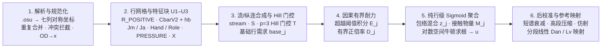

# SPM Rating v1.3.0 完整算法机制说明

[English](mechanism.md) · [模型概览](model.zh-CN.md) · [评估与取舍](evaluation.zh-CN.md) · [4K 参考标定](calibration-4k.zh-CN.md) · [时间处理](time.zh-CN.md) · [使用说明](../README.zh-CN.md)

---

本文完整给出 SPM Rating **v1.3.0** 从 `.osu` 谱面文本到原生难度分（`raw_score`）与社区参考刻度分（`reference_score`）的全部数学定义、结构动机、正则设计及两支生产模型 **`detail`（`V13-D1`，78 个连续拟合参数）** 与 **`compact`（`V13-C`，70 个连续拟合参数）** 的冻结参数取值。文中数值保留三至四位有效数字以利阅读，完整双精度常量以随包发布的 [detail.json](../spm_rating/models/detail.json) 与 [compact.json](../spm_rating/models/compact.json) 为准。

---

## §1 总体设计目标与计算管线

SPM Rating v1.3.0 源于 sunny-rework 七轨道手部坐标系，旨在解决多键下落式音游（osu!mania 4K / 6K / 7K）中长期存在的四个结构性难题：

1. **物理单调与边界稳定性**：在保持高排序精度的前提下，消除由负向通道对冲、无界减法恢复与自由高阶多项式导致的合成谱面排序倒挂与域外（OOD）梯度爆炸（91 项物理控谱违例从 `v1.2.0-rc3` 的 `120` 项严格清零为 `0`）。
2. **时间戳分裂连续性与零相位跳变**：在 ±1 ms 微扰与分拆和弦下保持需求曲线连续，并彻底废除“固定长度时间滑窗 + 两级幂均值”带来的窗原点相位敏感性，使聚合相位极差从数学上严格恒为 `0.0`。
3. **长条微观协同精细化**：用原生行网格上的按列锁手矩阵（`CbarV2`）与正定释放通道（`R_POSITIVE`）取代粗粒度全局计数，分辨“同手相邻占键 / 隔列钗叠 / 异手持键 / 尾部交错 / 盾型先导”。
4. **局部–全局一致性与可迁移标定**：以**按有效接触物量加权的 Log-Logistic 行级 Sigmoid 求根**替代固定窗分位数幂平均，在不损害整谱排名与参考标度的前提下，大幅提升局部 1–2 秒窗失误预测与跨游戏榜单（如 BMS 8 表）外推能力。

整条评分管线可分为六个阶段：

两支生产模型共享完全一致的核心代码路径（[v130_rev2.py](../spm_rating/v130_rev2.py)），差异仅在于对称处理与次级精简项：

- **`detail`（`V13-D1`）**：拥有 **78** 个连续拟合参数；对规范化原谱与其水平镜像谱分别运行前向物理场 `forward()`，再对非线性结果做算术平均（后平均），从构造上保证镜像对称误差严格为 `0.0`。
- **`compact`（`V13-C`）**：拥有 **70** 个连续拟合参数；对键位及长条尾部做词典序规范化后仅执行单方向前向计算（耗时约为 `detail` 的 `0.49×`），从 `CbarV2` 中略去 `lockanchor` 与 `shield` 两项，并将 `ga_shape`、`role_price`、`stam_theta`、`stam_half`、`pp_thr`、`pp_div` 6 个次级形态参数固定在先验常数上。
- **`detail-4k`**：底层复用 `detail` 的全部原生参数与前向/聚合算子，通过独立校验身份显式绑定 v1.3.0 分段线性 4K 段位映射（详见 [4K 参考标定](calibration-4k.zh-CN.md)）。

---

## §2 输入表示、坐标系与公共算子

### 2.1 七轨道嵌入与手部解剖分区

所有受支持的键数（$K_{\text{orig}} \in \{4, 6, 7\}$）在解析阶段统一嵌入一条固定 7 列骨架中，使相邻手指间隙、同手跨度与跨手跳跃拥有统一的几何语义：

| 原始键数 | 原始列编号 | 映射到的 7 列骨架位置 | 空置列 |
|---|---|---|---|
| **4K** | `0, 1, 2, 3` | **`1, 2, 4, 5`** | `0, 3, 6` |
| **6K** | `0, 1, 2, 3, 4, 5` | **`0, 1, 2, 4, 5, 6`** | `3` |
| **7K** | `0, 1, 2, 3, 4, 5, 6` | **`0, 1, 2, 3, 4, 5, 6`** | — |

7 列坐标系内的固定解剖分区为：

- **手部归属 `HAND`**：列 `0, 1, 2` 属左手（组 `0`），列 `3` 为中央拇指列（组 `1`），列 `4, 5, 6` 属右手（组 `2`）。
- **手指对称组 `AIN_GROUP`**：环指（`0, 6 → 0`）、中指（`1, 5 → 1`）、食指（`2, 4 → 2`）、拇指（`3 → 3`）。
- **边界链群 `BOUND_GROUP`**：8 条迁移边界 `0..7`（边界 `0` 仅含列 `0`、边界 `7` 仅含列 `6`，边界 `1..6` 分别合并相邻两列 `(k-1, k)`）按镜像对称归为 4 组 `[0, 1, 2, 3, 3, 2, 1, 0]`。

解析与规范化阶段还会执行以下不变量：
1. **重复合并与冲突拦截**：同列同时刻的完全重复音符预先去重；若同一时刻同一物理列出现尾部长度冲突的重叠对象，立即抛出 `ValueError` 拒绝评分。
2. **倍速折算**：速度倍率 $r > 0$ 通过线性插值 osu!mania OD 300g 判定窗口表（OD0 = `22.0 ms`、OD5 = `19.5 ms`、OD10 = `16.0 ms`）反算出等价的倍速后 $\mathrm{OD}_{\text{eff}}$，满足目标窗口 $= w(\mathrm{OD}) / r$。
3. **纯静态长条兜底**：若整张谱面或被裁剪区间仅剩单个同时行且含未结束长条（`span > 0`），自动在中点 $t_0 + 0.5\cdot\mathrm{span}$ 构造一条虚拟持键支撑行，确保后续求根稳定正定。

### 2.2 判定宽容度与行网格公共算子

总体判定难度 $\mathrm{OD}$ 仅通过基础打击宽容时间量 $x$（单位：秒）进入模型：

$$
q = \frac{64.5 - \lceil 3\,\mathrm{OD}_{\text{eff}} \rceil}{500}, \qquad
x_0 = 0.3\sqrt{\max(q,\, 10^{-6})}, \qquad
x = \min\!\big(x_0,\; 0.6(x_0 - 0.09) + 0.09\big).
$$

在常规 $\mathrm{OD} \in [0, 10]$ 内，$x$ 单调递减于约 `0.1007` 至 `0.0788` 秒之间。各基础物理通道再通过独立响应指数 $m_f$ 取幂 $x_f = x^{m_f}$：

| 通道 | 对应参数 | 冻结值 $m_f$ | 物理含义 |
|---|---|---:|---|
| 纵连 `Jm / Ja` | `od_mult_jm` | `1.204` | 判严时连打准度容错收窄 |
| 密度 `P` | `od_mult_p` | `1.129` | 判严时高速流维持代价上升 |
| 跨列转移 `X` | `od_mult_x` | `1.197` | 判严时高频换指时机误差上升 |
| 长条释放 `R` | `od_mult_r` | `1.059` | 判严时松尾时机敏感度上升 |

模型内所有时间序列均定义在**去重时间戳行网格** $\{t_0 < t_1 < \dots < t_{n-1}\}$ 上，相邻行间隔记为 $\Delta t_j = t_{j+1} - t_j$（毫秒），$d_j = \Delta t_j / 1000$（秒），且各谱面批内绝对隔离。贯穿全部特征核的两个平滑算子分别为：

- **居中步长积分均值 $\bar{v}(s; W)$**：将行网格右连续阶梯函数 $v(t)$ 在居中窗口 $[s - W/2,\, s + W/2]$（两端截断至本谱面起止范围）内精确积分并除以名义窗宽 $W$（单位：毫秒）：

$$
\bar{v}_W(t_j) = \frac{1}{W}\int_{\max(t_0,\, t_j - W/2)}^{\min(t_{n-1},\, t_j + W/2)} v(t)\,\mathrm{d}t.
$$

- **连续和弦耦合权重与双手指手势核**：当相邻行间隔小于耦合尺度 $\tau_c = 24.346\text{ ms}$（`chord_tau_c`）时，定义线性三角形同刻核 $K(\Delta) = \mathrm{clip}(1 - \Delta / \tau_c,\, 0,\, 1)$：
  - 后向衰减耦合权重 $w_b(r) = K(t_r - t_{r-1})$ 决定第 $r$ 行被视为“新攻击起点”的程度 $\mathrm{att}_r = 1 - w_b(r)$；
  - 左右手指手势规模按手部掩码 $\{0,1,2,3\}$（左含拇指）与 $\{4,5,6\}$（右）在窗口内作三角核计数：
    $$
    u_L(r) = \sum_{r'} \mathrm{left\_bits}(r')\, K(|t_{r'}-t_r|), \qquad
    u_R(r) = \sum_{r'} \mathrm{right\_bits}(r')\, K(|t_{r'}-t_r|).
    $$

---

## §3 基础物理需求通道

所有底层特征按架构职责分为三块提取（`U1`: 释放场，`U2`: 长条协调矩阵原语，`U3`: 纵连/手部/密度/跨列/不均匀度），并在原生前向核中参与下游组合。

### 3.1 连打与手部角色家族（`Jm`, `Ja`, 4K 三连, `hand`, `role`）

#### (1) 单列纵连核与跨列加权聚合

对物理列 $k \in \{0,\dots,6\}$，记同列前后两次音头的有效间隔为 $g$（秒，下限 $10^{-4}\text{ s}$），基础同指连打瞬时核为：

$$
\mathrm{kern}_k(g, x) = \frac{1}{g \cdot \big(g + j_{c1}\, x_k^{1/4}\big)}, \qquad j_{c1} = 0.1613,\quad x_k = x^{m_{jm}}.
$$

v1.3.0 **彻底移除了旧版的负向局部凹凸惩罚项（`j_nerf_a = 0`）** 与 **对高密和弦稀释（`mj_dilute = -0.022` 已不稀释和弦主体）**，保证纵连核关于频率严格单调递增。各列先在特征窗 `w_jm`（`878.6 ms`）上做居中平滑得 $C_k(t)$，再按同指速率权重 $w_k = 1/g_k$（`Jm` 通路同样对 $1/g_k$ 做 `w_jm` 平滑）沿活跃列作 $p = 2.805$（`j_agg_pow`）幂平均：

$$
J(t) = \left( \frac{\sum_{k=0}^6 \bar{w}_k(t)\, \big[\bar{v}_{w_{jm}}(C_k)(t)\big]^{j_{\mathrm{pow}}}}{\sum_{k=0}^6 \bar{w}_k(t) + \epsilon} \right)^{1/j_{\mathrm{pow}}}.
$$

在此基础上衍生出三条子输出：
- **三连快叠正增量（4K 专用）**：连续三颗同列音头若总跨度 $\Delta_3 < 2 h_3$（$h_3 = 141.0\text{ ms}$），激活线形三连指标 $\tau_3 = \max(0,\, 1 - \Delta_3 / (2 h_3))$；`v130_rev2` 仅在 **4K** 谱面上把三连相对于普通双押连打的正差额 $\max(J_{\mathrm{trip}} - J_m,\, 0)$ 以非负权 `j_triple_4k`（`detail 0.2552 / compact 0.8626`）加入 $J_{m,\text{raw}}$（7K 三连不再负向扣分）。
- **长连锚通道 `Ja`**：在同一同指核上乘以连续跟拍链长调制 $\left(\frac{e}{e + 4.913}\right)^{0.874}\left(1 + \frac{\mathrm{other}}{n_{\mathrm{rows}}}\right)^{0.0126}$，其中 $e = \max(\mathrm{runlen} + 1,\, 0)$ 统计相邻间隔 $\le 251.0\text{ ms}$ 的连打阶梯长度。
- **快叠直加项 `FJ`**：对同列间隔 $g < 0.15\text{ s}$ 的极短连打，额外提取边界线性衰减项 $g^{-1}(1 - g/0.15)$，经 `w_jm` 平滑后按 7K `1.291` / 4K `1.189` 直接叠加。

#### (2) 手部共享重复接触超额（`hand.py` & `hand_cost.py`）

单凭每列各自计数无法区分“独立一根手指反复点击”与“同一只手在不同手指间协同抢节拍重复接触”。`hand.py` 对两套中央拇指归属配置 $\pi_0=[0,0,0,0,1,1,1]$ 与 $\pi_1=[0,0,0,1,1,1,1]$（scale $\tau = 30\text{ ms}$）分别执行：

1. 使用五次光滑阶跃 $S_5(u) = u^3(10 - 15u + 6u^2)$（$u \in [0,1]$）计算同列合法性 $l_j = S_5(\Delta t_{\text{lane},j} / \tau)$；再统计同手插花数 $c_j = \sum_{m \in (i, j),\, h_m = h_j} S_5((t_m-t_i)/\tau) S_5((t_j-t_m)/\tau)$，令手部共享候选权重 $e_j = l_j (1 - S_5(c_j))$。
2. 计算共活数 $u_j$，并通过同手脉冲包络上界截断分配每颗音头的归一化共享重复权重 $m_j^{\mathrm{hand}}$；将事件权重经半径 $\tau = 30\text{ ms}$ 的单元积分余弦平方脉冲解析分布并求和于 `w_jm` 窗内，得出**手部速率场** $H_h(t)$ 与该手内**最忙单指速率上包络** $I_h(t) = \max_{k \in h} L_k(t)$。
3. 选用“额外任务先验”对超出单指部分施加 Sunny 速率成本 $f(r) = \frac{r^2}{1 + k r}$（$k = j_{c1} x_{jm}^{1/4}$）：

$$
\mathrm{extra\_hand}(t) = \sqrt{\frac{1}{2}\sum_{\pi \in \{\pi_0,\pi_1\}} \max_{h \in \{L, R\}} f\Big(\max\big(H_h^{(\pi)}(t) - I_h^{(\pi)}(t),\, 0\big)\Big)^2}.
$$

#### (3) 长条持续占键后的手指角色负担（`role.py`）

持续按住长条的手指刚释放或正处于占键上下文中时，再次触发同类击打负担显著增大。`role.py` 先合并同列重叠长条得到离散持键区间，算出每个音头前 `w_jm` 窗内的占空比 $d_i \in [0, 1]$，以及前后最近同指间距 $g_i = \max(\min(g_{\text{prev}}, g_{\text{next}}),\, 10^{-4})$，赋予凸二次动作预算：

$$
w_i^{\mathrm{role}} = \frac{d_i^2}{g_i + k}, \qquad d_{\mathrm{role}}(q) = \max_{k \in \{0,\dots,6\}} \sum_{i:\,\mathrm{col}_i=k,\, |\Delta t| < W/2} w_i^{\mathrm{role}} \cdot \frac{2000}{W}\cos^2\!\left(\frac{\pi \Delta t}{W}\right),
$$

其中 $W = w_{jm}$。关键的结构隔离是：**下游计算将纯纵连上下文 $J_{\mathrm{ctx}}$ 与手部/角色修正纵连 $J_m$ 严格分离**：

$$
J_{\mathrm{in}} = \max\!\big(J_{m,\mathrm{raw}} + \mathrm{extra\_hand} + \text{role\_price}\cdot d_{\mathrm{role}},\, 0\big), \qquad
J_b = A^{\frac{a_j}{K_s}} \min\!\big(J_{\mathrm{in}},\, \mathrm{cap}_a + \mathrm{cap}_b J_{\mathrm{in}}\big),
$$

其中 `cap_a = 22.111, cap_b = 0.5877` 为软上界斜坡，$J_{b,\mathrm{ctx}} = A^{\frac{a_j}{K_s}} \min(J_{m,\mathrm{raw}},\, \mathrm{cap}_a + \mathrm{cap}_b J_{m,\mathrm{raw}})$ 专供后续 $p=3$ Hill 门控使用，避免长条手部附加负载误抑制跨列技术通道。

---

### 3.2 密度、和弦结构与同手拥挤度（`PRESSURE` & `hc`）

#### (1) 基础节奏压力与长条身占比

记 $d_{\mathrm{fp}}$ 为到下一个独立攻击起点（`wb <= 0`）的时间跨度，$x_p = x^{m_p}$，容错调制与长条身体占用率增益定义为：

$$
q = \min\!\left(d_{\mathrm{fp}} - \frac{x_p}{2},\; \frac{x_p}{6}\right), \qquad
f_p = \left[\max\!\left(\frac{p_{\mathrm{scale}}}{x_p}\left(1 - \frac{p_{\lambda 3}}{x_p} q^2\right),\, 0\right)\right]^{1/4},
$$

$$
v = 1 + p_{\lambda 2}\, \frac{\mathrm{held}\cdot \Delta t_{\mathrm{ms}}}{\max(\Delta t_{\mathrm{ms}}, 1)^{p_{v\mathrm{norm}}}}, \qquad
\mathrm{inc}_0 = \frac{f_p}{d} \Big((1 - w_b) + \max(v - 1,\, 0)\Big).
$$

随后乘以基于 7 列 800 ms 用量降序比率的局部孤立占键校正因子 $\mathrm{anchor} = 1 + a_{\mathrm{on}} \min(r_a - a_0,\, c_3 (r_a - a_1)^3)$ 并通过下斜坡软钳 $\min(\mathrm{inc}\cdot\mathrm{anchor},\, \max(\mathrm{inc},\, p_{\mathrm{sat},b}\,\mathrm{inc} - p_{\mathrm{sat},a}))$ 得 $\mathrm{inc}_+$，在特征窗 `w_p`（`956.4 ms`）内平滑给出基础密度 `row[3]`。

#### (2) 构造单调的双手结构和弦定价

为消除旧版二次和弦表在高多押下的非单调失真，v1.3.0 以对称双手指检测 $(u_L, u_R)$ 与单调 $L_P$ 范数构造和弦超额：

$$
g_{\gamma, q}(u_L, u_R) = 1 + \Big[\big(u_L^{\gamma q} + u_R^{\gamma q}\big)^{1/(\gamma q)} - 1\Big]_+.
$$

注意当 $\gamma \ge 1$ 时，$g(2,0) > g(1,1) > g(1,0) = 1$ 对任意双指加法均严格成立（同手叠押比双手对称押更难，孤立单点增量严格为 `0`）。特征层在两组几何基底 `SHAPE1 = (1.14, 1.1)` 与 `SHAPE2 = (1.62, 1.48)` 上提取 $\bar{v}_{w_p}\big(\mathrm{inc}_+(g_{\gamma,q}-1)_+\big)$，下游通过形状凸组合权 `ga_shape` 与总缩放 `ga_alpha` 并叠加 `100 ms` 爆发脉冲密度 `row[6]`（平滑后乘 `p_burst3`）：

$$
\mathrm{pp} = \mathrm{row}_3 + \mathrm{ga\_alpha}\big((1-\mathrm{ga\_shape})\,\mathrm{row}_4 + \mathrm{ga\_shape}\,\mathrm{row}_5\big) + p_{\mathrm{burst3}}\,\mathrm{row}_6.
$$

此外，同一只手在行内出现 $>1$ 颗音头时，在窗宽 `shd_w`（`1007.2 ms`）内提取一阶和 $2.2$ 次幂同手超额 $\mathrm{hc}_e = \bar{v}_{\mathrm{shd\_w}}\big((u_L-1)_+^e + (u_R-1)_+^e\big)$，并按 $\eta = (h_{c,e} - 1)/1.2$ 线性插值为 $\mathrm{hc} = (1-\eta)\mathrm{hc}_1 + \eta\,\mathrm{hc}_{2.2}$，以严格非负权 `d_hc`（`detail 0.1274 / compact 0.0076`）并入流分支。

---

### 3.3 节奏不均匀度乘子（`Abar`）

`Abar` 对每对在 $\pm 150\text{ ms}$ 内均活跃的跨列邻居比较它们各自到下一击的时间差 $d_0, d_1$，构造焊接连续的分段惩罚乘子：

$$
dd = |d_0 - d_1| + w_{mx}\max(0,\, \max(d_0,d_1) - \theta_{mx}),
$$

$$
\mathrm{val}(dd) =
\begin{cases}
\min(c_0 + w_m \max(d_0,d_1),\, 1), & dd < \theta_{\mathrm{lo}},\\[2pt]
\min(c_0 + k_{\mathrm{a}}(dd - \theta_{\mathrm{lo}}) + w_m \max(d_0,d_1),\, 1), & \theta_{\mathrm{lo}} \le dd < \theta_{\mathrm{hi}},\\[2pt]
1, & dd \ge \theta_{\mathrm{hi}}.
\end{cases}
$$

其中 $\theta_{\mathrm{lo}} = 0.0139\text{ s},\, \theta_{\mathrm{hi}} = 0.1160\text{ s}$。全部活跃列对乘子连乘后于 `75.76 ms` 短窗内平滑并乘 `abar_scale = 0.9940`，得到处处光滑的纯倍乘节奏因子 $A_j \in (0, 1]$。均匀无偏移的纯流 $A \approx 0.65\text{–}0.73$，而强拆拍/切分/多变变速段迫近 `1.0`。

---

### 3.4 正定长条释放通道（`R_POSITIVE`）

针对长条释放阶段，v1.3.0 保留并精简了三段正定贡献（于长条尾窗 `w_r` 内居中平滑并截断为非负）：

1. **逐尾释放段**：对长条尾 $t_i$ 至紧邻下一事件 $t_{\mathrm{nxt}}$ 的时间距 $d_{\mathrm{tr}} = \max((t_{\mathrm{nxt}} - t_i)/1000,\, 0.00405)$，定义两端压力指标 $I$：
   $$
   I_h = \frac{0.001\,|\mathrm{dur}_i - 80|}{x_r}, \qquad I_t = \frac{0.001\,|t_{\mathrm{nh}} - t_i - 80|}{x_r},
   $$
   $$
   I = \frac{2}{2 + \exp\!\big(-r_{\mathrm{steep}}(I_h - r_{\mathrm{off}})\big) + \exp\!\big(-r_{\mathrm{steep}}(I_t - r_{\mathrm{off}})\big)},
   $$
   再按释放逆平方根急迫度计算基底价值，并连续融合协同、锁手、内指钉住与短条渐消因子：
   $$
   \mathrm{rv}_i = r_{\mathrm{tail}}\, d_{\mathrm{tr}}^{-1/2}\, x_r^{-1}\,(1 + r_{I,w} I)\cdot s_{\mathrm{same}}\cdot \mathrm{cw}^{e(\beta)}\cdot R_{\mathrm{short}}(\mathrm{dur}_i)\cdot (1 + r_{\mathrm{lock}} L_i)\cdot \frac{1 + r_{\mathrm{straddle}} S_{0,i}}{1 + 1.14\, \mathrm{outer}_i / \max(\mathrm{drive}_i, 0.3)}\cdot \rho_{\mathrm{edge}},
   $$
   其中：
   - $\mathrm{cw}$ 区分同列 `1.538` / 同手 `0.466` / 拇指 `0.012` / 跨手 `0.732`；
   - 指数混合因子 $\beta = \mathrm{clip}(0.5 - (t_{\mathrm{nt}} - t_{\mathrm{nh}})/(2 r_{\mathrm{sim\_tau}}),\, 0,\, 1)$ 在双事件相近（$r_{\mathrm{sim\_tau}} \approx 11.4\text{–}13.4\text{ ms}$）时连续插值；
   - $\mathrm{outer}_i$ 与 $S_{0,i}$ 测度外指与内指的持键协同关系（`r_ain = [0, 2.467, 2.502, 1.270]`）；
   - `_edge_ramp` 在边界最后 `20%`（截断窗 `r_dt_max = 6750 ms`）处采用Raised-Cosine平稳衰减至零并按有效跨度守恒归一化。
2. **尾–尾序列段**：相邻两尾间按 `r_seq = 0.0664`、$d_{\mathrm{tr}}^{-1/2}/x_r$ 连续计费。
3. **三尾同手顺序反转惩罚段**：同手连续三个不同列长条尾若在 `r_order_tau = 702.5 ms` 内发生非单调折返，按列距超出部分（$\mathrm{jump} - (\max c - \min c)$）及非对称间隔比 $(0.45 + 0.85 \cdot \frac{|e_1-e_2|}{\max(e_1+e_2, 1)})$ 以 `r_order_pen` 计入正惩罚。

### 3.5 行网格长条协调（`CbarV2` & `hb`）与 **4K 专属门控 `ln_gate_4k`**

在长条协调支路上，v1.3.0 彻底放弃早期的标量总按住数惩罚，改为全非负行网格组合：

1. **混键周期性指标（`hb.py`）**：
   - **释放拥挤度 `churn`**：对长条尾脉冲经 `1167.7 ms` 平滑后的释放拥挤度 $r$ 施加凹饱和映射 $\frac{r}{1 + r / 20.707}$，并在 4K 上额外乘 `1.17274`，避免 20+ tail/s 墙体谱被线性外推拉爆。
   - **持键年龄 `holdage`**：同列活跃长条持续占用时长（上限 `0.4247 s`）超出阈值 `0.1572 s` 的净累计，并在 4K 上乘 `0.54386`。
2. **对称 7×7 跨列锁手质量矩阵与六项原语（`lncoord_v2.py`）**：
   定义对称距离矩阵 $M[c, j]$（对角为 `0`），把列对 `(c, j)` 划分为五组独立拟合权重：**同手相邻 `sh_adj`**、**同手隔列 `sh_split`**、**拇指桥接 `1h_split`**、**跨手相邻 `2h_split`** 与 **跨手远隔 `cross`**。行 $r$、列 $k$ 所受的局部锁手质量即为：
   $$
   L_k(r) = \sum_{j \ne k} M[k, j]\, \mathrm{held}_j(r).
   $$
   在 `cbv_w` 窗口（`detail 358.2 ms / compact 275.5 ms`）平滑下，组装如下严格非负原语进入下游矩阵线性组合：
   - **异手持键敲击 `xh_holdtap` & 同手叠加附加项 `sh_holdtap_extra`**：真实点按（Tap）受其余已按住列的基线锁手与同手加价，**严禁将新按下长条头自身计入锁手基数**。
   - **锁手连打 `lockstack`**：先算每列独立连打核、加窗平滑后再按列各自乘 $L_k^{0.979}$，最后列间 2.805 次幂平均。
   - **锁手锚 `lockanchor`（`compact` 省略）**：结构同 `lockstack`，在按列乘锁手前叠加与 `Ja` 同形的连跑链长门控。
   - **盾型先导 `shield`（`compact` 省略）**：同列前音距长条头 $\le 330.6\text{ ms}$ 时触发余弦/指数衰减因子 $e^{-\Delta t/498.2}$，再乘 $(1 + \mathrm{cbv\_sh\_lock}\cdot L_k)$；若前音自身也是长条，则随其时长衰减。
   - **隔列钗叠 `straddle`**：遍历间距 $d \in \{2, 3\}$ 的列对 $(a, b)$，仅当中间轨道存在真实活跃可能时计算几何平均负荷与对称平衡度交互中间被钉指权重：
     $$
     \sqrt{r_a r_b}\left(\frac{2\min(r_a, r_b)}{r_a + r_b + \epsilon}\right)^{\mathrm{bal}} \sum_{a < m < b} \mathrm{held}_m\, h_{\mathrm{AIN}(m)},
     $$
     下游乘正权 `straddle` 并入 `cb`。
   - **完整协同与错位面叠合成项（`overlap` 加权）**：将完整六项 `CbarV2.curve()`（内含严格排除包含关系、仅对真交错长条 $t_i < t_j < e_i < e_j$ 计费的 `overlap_steps`）再经独立非负系数 `overlap` 汇入 `cb`。

将以上全部正定长条协同汇总为 `cb`，再与释放通道 `R` 共同通过密度压制门控（并消除 4K 低段长条过估）：

$$
R_{\text{eff}} =
\begin{cases}
R_{\text{raw}}\cdot \frac{C}{C + \mathrm{ln\_gate}}\cdot \frac{C}{C + \mathrm{ln\_gate\_4k}}, & K_{\text{orig}} = 4,\\[4pt]
R_{\text{raw}}\cdot \frac{C}{C + \mathrm{ln\_gate}}, & K_{\text{orig}} \in \{6, 7\},
\end{cases}
\qquad
\mathrm{cb}_{\text{eff}} =
\begin{cases}
\mathrm{cb}\cdot \frac{C}{C + \mathrm{ln\_gate\_4k}}, & K_{\text{orig}} = 4,\\[4pt]
\mathrm{cb}, & K_{\text{orig}} \in \{6, 7\}.
\end{cases}
$$

`ln_gate_4k`（`detail 9.709 / compact 9.336`）在局部密度 $C$ 较低的低段 4K 长条上温和衰减多余释放与锁手溢价，而在高密高段 ($C \gg 10$) 渐近趋于 `1`，且完全不影响纯 Rice 谱面。

---

### 3.6 跨列转移通道（`X_base` 与 $C^1$ 快速切换 `X_fast`）

跨列转移沿着 8 条有序边界评估手指位移切换负载。首先，为消除同刻和弦错位 `1 ms` 带来的跳跃边界跳变，对每条边界事件使用 $\pm \tau_c$ 内的平滑余弦平方坐标：

$$
e(q) = \frac{(b-1)\, w_{b-1}(q) + b\, w_b(q)}{\max(w_{b-1}(q)+w_b(q),\, 10^{-12})}, \qquad
w_k(q) = \cos^2\!\left(\frac{\pi}{2}\,\mathrm{clip}\!\left(\frac{|q - t_{\text{nearest},k}|}{\tau_c},\, 0,\, 1\right)\right).
$$

在满足同边界连续事件间隔 $\Delta t \ge \tau_c$ 后，提取两类正定曲线并在 `w_x = 848.9 ms` 窗口上平均：
- **基础转移 `X_base`**：$\mathrm{amp} = x_{\mathrm{amp}} \max(g, x_x)^{-2}(1 + x_{\mathrm{din}}\Delta_{\mathrm{in}} + x_{\mathrm{dout}}\Delta_{\mathrm{out}})$，按镜像边界组权 `x_cw0..3` 加权求和；
- **$C^1$ 真跨列连续快切 `X_fast`**：针对列掩码真变化且连续跨越相邻两条边界的连续切换，利用判定宽容度正则距离 $b = \sqrt{g^2 + (0.57 x_x)^2}$ 与 Softplus 平滑激活（$7\ln(1+e^{\mathrm{drive}/7})$），再取相邻边界项几何均值后乘以 `x_fc_w`，最后合成 $X = x_{\mathrm{base}} X_{\mathrm{base}} + x_{\mathrm{fast}} X_{\mathrm{fast}}$。（注：原静态边界邻接残差 `x_context` 在优化与零效应审计中稳定趋零并已剪除。）

---

## §4 需求合成与 $p=3$ Hill 门控

在每行 $j$ 处，流负荷支路先把密度、释放、长条协调与同手加权汇总，再接受全局 `Abar` 指数调制 $A^{a_p}$：

$$
\mathrm{stream}_j = A_j^{a_p}\left(a_{P,\text{key}}\,\mathrm{pp}_j + a_{R,\text{key}}\frac{R_{\text{eff},j}}{C_j + a_c} + a_{C,\text{key}}\frac{\mathrm{cb}_{\text{eff},j}}{C_j + a_{cbc}} + d_{hc}\,\mathrm{hc}_j\right),
$$

其中 4K 使用独立的 `a_p_4k`、`a_r_4k`、`a_cb_4k` 系数，以精确反映 4 键与 6/7 键在密度与协调权重上的物理尺度差。随后与经软钳和 $A^{a_j/K_s}$ 调制的 $J_b$、$J_a$ 通过 $L_{s_p}$ 幂平均合成为主运动支路 $S_j$：

$$
S_j = \left( c_{jm}\, J_{b,j}^{s_p} + c_{ja}\, J_{a,j}^{s_p} + c_s\, \mathrm{stream}_j^{s_p} \right)^{1/s_p}.
$$

跨列技术难度 $T_j$ 采用三次（**$p=3$**）**Hill 门控**耦合 $X_j$、$S_j$ 与裸连打上下文 $J_{\text{ctx}, j}$：

$$
T_j = A_j^{\frac{a_t}{K_{s,j}}} \cdot \frac{X_j}{X_j + S_j + t_{s,\text{off}}} \cdot \frac{X_j^3}{X_j^3 + (k_j J_{\text{ctx}, j})^3 + 10^{-12}},
$$

其中 $k_j$ 区分 4K (`k_jt_4k`) 与 6K/7K (`k_jt`)。选择 $p=3$ 而非早期的线性减法或 $p=2$ 的物理原因在于：

- 一阶导数在 $X \to 0$ 处更加平缓，可在**高爆发纵连段**（$J_{\text{ctx}} \gg X$）陡峭切断由偶发晃指产生的虚假技术加成，防止双押纵连图被误抬为高星 tech；
- 全域保证 $T_j > 0$ 且关于 $X_j$ 严格单调递增、关于 $J_{\text{ctx},j}$ 单调非增，彻底消除早先线性减法 $X - k J$ 归零断裂与奇点振荡。

最终，基础瞬时行需求为：

$$
D_{0, j} = d_{b1}\, S_j^{d_{ds}}\, T_j^{d_{dt}} + d_{b2}\, S_j + \mathrm{hold\_floor}\cdot H_{\mathrm{sup}, j}。
$$

---

## §5 因果有界耐力（Causal Bounded Stamina）

为避免早先减法恢复通道把短爆发或孤立高难段反常压低至零，v1.3.0 采用严格因果、正有界的前向滞后指数曝光机制。从 $E_0 = 0,\, \mathrm{prev}_0 = 0$ 出发，对于 $j \ge 1$ 记 $\Delta t_j = t_j - t_{j-1}$ 与时间常数 $\tau = \tau_{\mathrm{stam}}$（约 `43.6–44.2 s`），有效负荷超额 $\Delta_{\mathrm{prev}} = \max(0,\, D_{0, j-1} - \theta_{\mathrm{stam}})$ 按是否跨过 `440 ms` 休息临界分段累积与衰减：

$$
E_j =
\begin{cases}
E_{j-1} e^{-\Delta t_j / \tau} + \Delta_{\mathrm{prev}}\left(1 - e^{-\Delta t_j / \tau}\right), & \Delta t_j \le 440\text{ ms},\\[4pt]
E_{j-1} e^{-\Delta t_j / \tau} + \Delta_{\mathrm{prev}}\left(1 - e^{-440 / \tau}\right)e^{-(\Delta t_j - 440)/\tau}, & \Delta t_j > 440\text{ ms}.
\end{cases}
$$

最终逐行难度为：

$$
D_j = D_{0, j}\left(1 + c_{\mathrm{stam}} \frac{E_j}{E_j + \mathrm{stam\_half}}\right).
$$

该形式具有三项数学保证：① **严格因果**（第 $j$ 行完全只依赖过去行，绝不受前方休止或未来段干扰）；② **停顿分段封闭**（超过 `440 ms` 的休止自动截断单步主动加荷）；③ **严格有界递增**（倍率严格位于 $[1,\; 1 + c_{\mathrm{stam}}]$ 之间，`c_stam ≈ 0.16`，不可能产生零分或负崩塌）。

---

## §6 纯物量加权行 Sigmoid 求根聚合

v1.3.0 彻底摒弃了会随时间切割原点漂移的两级固定时间滑窗聚合，直接工作在原生行时间网格上。

### 6.1 局部包络混成与接触物量

1. **峰值包络混成**：在半半径 $h = \max\big(1,\, \mathrm{round}(0.5\cdot \mathrm{env\_ms} / \max(\mathrm{median}(\Delta t), 1))\big)$（`env_ms = 265.1 ms`）上以单调队列求滑动最大值 $e_j = \max_{|k-j|\le h} D_k$，线性混成为每行的有效局部需求：
   $$
   z_j = (1 - w_e) D_j + w_e e_j \qquad (\text{`detail` } w_e = 0.1120,\; \text{`compact` } w_e = 0.1588).
   $$
2. **行接触物量 $M_j$**：记该行的半邻接时间跨度上限 $q_j = \min(\max(\mathrm{gp}_j, 0),\, 387.12377)$（$\mathrm{gp}_j = 0.5(\Delta t_{j-1} + \Delta t_j)$），局部密度 $c_j = \max(C_j, 10^{-6})$，每行物量定义为：
   $$
   M_j = \frac{c_j^2}{c_j^2 + 4}\, c_j^{p_{\mathrm{mass}}}\, q_j^{p_{\mathrm{gap}}}\, \exp\!\left(-h_{\mathrm{mass}} \frac{\mathrm{held}_j}{\mathrm{held}_j + 51.9327}\right).
   $$
   在最终纯模型中 `mass_pow` 稳定在 `0.950–0.984`（接近物理线性计数而非早期滑窗的 `2.55` 高次幂扭曲），同时在密集尾部持续持键期间通过指数衰减适度抑制纯粹“按着不放的高密度撑分效应”。

### 6.2 Log-Logistic 隐式求根方程与数学性质

以挑战水平 $u > 0$ 为自变量，定义单行 $j$ 在能力阈值 $u$ 下的 Log-Logistic 局部通过概率为：

$$
\mathrm{acc}(z_j, u) = \sigma\!\left(\beta \ln\frac{u}{z_j} - \ln\frac{1-\gamma}{\gamma}\right) = \frac{u^\beta}{u^\beta + \frac{1-\gamma}{\gamma}\, z_j^\beta},
$$

其中 $\sigma(x) = (1+e^{-x})^{-1}$ 为标准 Sigmoid，$\beta$ 为陡度（`detail 8.959 / compact 9.893`），$\gamma \in (0, 1)$ 为目标参与通晓阈值（`detail 0.9640 / compact 0.9510`）。谱面或片段的聚合分 $u^*$ 定义为**按物理接触物量加权的平均准度恰等于 $\gamma$ 时的唯一正实根**：

$$
F(u) = \frac{\sum_{j=0}^{n-1} M_j\, \mathrm{acc}(z_j, u)}{\sum_{j=0}^{n-1} M_j} - \gamma = 0.
$$

该聚合器天然满足四条公理性质：
1. **严格一阶正尺度齐次性**：若全部行需求等比放大 $z_j \mapsto c\,z_j\ (c > 0)$，则必有 $u^* \mapsto c\,u^*$。
2. **关于局部需求严格单调**：因 $F'(u) > 0$ 且 $\partial \mathrm{acc}/\partial z_j < 0$，抬高任意正物量行（`M_j > 0`）难度必严格推升全局根 $u^*$。
3. **聚合窗原点相位极差严格为 `0.0`**：整套聚合没有任何固定步长分桶，消除了滑窗割裂造成的一切相位抖动。
4. **数值稳定与高速收敛**：`relative()` 在对数困难空间 $t = \ln u$ 上利用全区间保底的 Newton-Raphson 迭代求根（最多 80 步，实际约 5–8 步达机器精度），每张谱面平均求根耗时仅约 `0.062 ms`。

---

## §7 后处理标定、参考映射与时间契约

### 7.1 原生后校准（Post-Aggregation）

由求根得到的标量 $u^*$ 依次经过固定短谱长度衰减（已固定 $n_0 = 7.6$ 以防短控谱 OOD 杠杆爆炸）、平滑高端压制折线和仿射缩放置换：

$$
u_1 = u^* \cdot \frac{n_{\mathrm{heads}}}{n_{\mathrm{heads}} + 7.6}, \qquad
u_2 =
\begin{cases}
u_1, & u_1 \le \mathrm{pp\_thr},\\
\mathrm{pp\_thr} + \dfrac{u_1 - \mathrm{pp\_thr}}{\mathrm{pp\_div}}, & u_1 > \mathrm{pp\_thr},
\end{cases}
\qquad
\mathrm{raw\_score} = u_2 \cdot \mathrm{pp\_scale} + \mathrm{pp\_bias}.
$$

其中 $\mathrm{pp\_scale} = 0.9745$、$\mathrm{pp\_bias} = 0.6824$ 构成固定的全局输出尺度锚（`detail` 与 `compact` 共享同一物理 `raw_score` 量纲，但在高端截断点 $\mathrm{pp\_thr} = 10.581 / 8.416$ 与斜率衰减 $\mathrm{pp\_div} = 1.980 / 1.560$ 上按模型差异化）。

### 7.2 社区分段线性参考标定（`reference_calibration`）

每个键数各自通过五折隔离校验下的有序等距/分位节点 $\{(k_0, k_1, \dots, k_m)\}$ 与正斜率 $\{a_0, \dots, a_{m-1} > 0\}$ 定义连续严格递增分段线性函数 `align(cal, raw)`（边界外分别以首斜率 $a_0$ 和末斜率 $a_{m-1}$ 线性外推），映射出三个互相独立的参考尺度：
- **4K → `dan`**：以宽跨度 4K 段位全梯度面板单独标定，范围约 `1.0–18.3 Dan`；`detail-4k` 显式复用 `detail` 的同一 4K 映射节点。
- **6K → `lv`**：以 6K 社区等级样本标定。
- **7K → `dan_sr`**：以综合 7K 难度样本（`3.8 + 0.435 * dan` 口径）标定。

### 7.3 片段模式与小数原谱时间连续延拓

- **`context` 模式**：在完整母谱上计算全部特征场与因果耐力 $E_j$，然后仅提取选定时间半开区间 `[start_ms, end_ms)` 内的行（保留不少于 2 颗物理音头），在同一 Row Sigmoid 聚合器中求根输出。
- **`isolated` 模式**：独立裁出区间内的音符并把穿出 `end_ms` 的长条尾部截断于终点，重新构建物理状态评分。
- **小数原始时间戳延拓（[clock.py](../spm_rating/clock.py)）**：对于原谱经亚毫秒整体/偏置移动含小数时刻的输入，在共享舍入相位 $U \in [0, 1)$ 下构造分段不变的量子化图表 $Q_U(t) = \lfloor tr + U \rfloor / r$，在相邻断点区间之间以精确区间权重求期望积分 $F_{\mathrm{ext}} = \int_0^1 F(Q_U(\mathrm{chart}))\,\mathrm{d}U$（详见 [时间处理说明](time.zh-CN.md)）。

---

## §8 冻结模型参数对照总表

下表按机制通道归类列出 `detail`（78 个活跃连续拟合参数）与 `compact`（70 个活跃连续拟合参数 + 6 个继承常数 + 2 项省略模块）的全部活跃配置参数（四舍五入至 3–4 位有效数字）：

### 8.1 下游合成、Hill 门控、耐力与 Sigmoid 聚合（27 参）

| 参数 | `detail` | `compact` | 作用与物理位置 |
|---|---:|---:|---|
| `c_jm` / `c_ja` / `c_s` | `0.2912` / `0.00015` / `0.1919` | `0.4006` / `0.000553` / `0.2645` | 运动支路幂平均权重（迷你叠 / 长连锚 / 流） |
| `s_p` | `1.460` | `1.269` | 运动支路 $L_{s_p}$ 幂次 |
| `aj` / `ap` / `at` | `2.352` / `2.946` / `25.23` | `2.021` / `2.796` / `32.76` | `Abar` 幂调控指数（连打 / 流 / 技术） |
| `a_p` / `a_p_4k` | `0.2612` / `0.9024` | `0.2019` / `0.7195` | 流支路密度权（6K·7K / 4K） |
| `a_r` / `a_r_4k` | `92.52` / `73.51` | `129.4` / `72.22` | 流支路释放权（6K·7K / 4K） |
| `a_c` | `25.08` | `34.44` | 释放项局部密度分母偏移 $C + a_c$ |
| `a_cb` / `a_cb_4k` | `6.724` / `11.64` | `7.271` / `18.24` | 流支路长条协调权（6K·7K / 4K） |
| `d_hc` | `0.1274` | `0.00760` | 同手和弦超额通道权 |
| `ga_alpha` / `ga_shape` | `0.0008` / `0.4777` | `0.0706` / `0.42` *(定)* | 构造单调和弦价格规模与形态插值比 |
| `p_burst3` | `0.1276` | `0.1572` | 100 ms 短突发密集冲击附加权 |
| `x_base` / `x_fast` | `0.7290` / `2.486` | `0.5917` / `2.437` | 基础跨列切换与 $C^1$ 真跨连续快切权 |
| `k_jt` / `k_jt_4k` | `0.3395` / `1.153` | `0.2342` / `0.4801` | $p=3$ Hill 门控纵连抑制尺度（6K·7K / 4K） |
| `t_s_off` | `2.118` | `1.322` | Hill 门控分母偏置 |
| `d_b1` / `d_ds` / `d_dt` / `d_b2` | `1.735` / `0.5548` / `0.6745` / `0.5522` | `1.634` / `0.5414` / `0.9043` / `0.4755` | $D_0 = d_{b1} S^{d_{ds}} T^{d_{dt}} + d_{b2} S + \dots$ |
| `c_stam` / `tau_stam` | `0.1573` / `43638 ms` | `0.1600` / `44234 ms` | 因果有界耐力增益上限与衰减时间常数 |
| `stam_theta` / `stam_half` | `2.665` / `2.513` | `1.0` *(定)* / `2.8` *(定)* | 耐力积累触发阈值与半饱和暴露度 |
| `sig_beta` / `sig_gamma` | `8.959` / `0.9640` | `9.893` / `0.9510` | Row Sigmoid 陡度 $\beta$ 与目标率 $\gamma$ |
| `mass_pow` / `gap_pow` / `hold_mass` | `0.950` / `1.336` / `0.7257` | `0.9844` / `1.406` / `4.545` | 接触物量：密度幂 / 行隙幂 / 持键衰减 |
| `env_w` / `env_ms` | `0.1120` / `265.1 ms` | `0.1588` / `265.1 ms` | 局部峰值包络混成比与全窗宽 |
| `pp_thr` / `pp_div` | `10.58` / `1.980` | `8.416` *(定)* / `1.560` *(定)* | 后处理高端压制折点与除法压缩率 |

### 8.2 长条释放、协调、角色与特征窗口（51 参）

| 通道组 | `detail` 取值 | `compact` 取值 | 说明 |
|---|---|---|---|
| **Role / 4K 叠 / LN 门** | `role_price=0.4500`, `j_triple_4k=0.2552`, `ln_gate=0.2409`, `ln_gate_4k=9.709` | `role_price=0.1022` *(定)*, `j_triple_4k=0.8626`, `ln_gate=0.1696`, `ln_gate_4k=9.336` | `ln_gate_4k` 专抑制 4K 低段长条过估 |
| **混键周期 (`hb`)** | `churn=7.922`, `holdage=32.00` | `churn=8.470`, `holdage=31.71` | 饱和尾部拥挤度与超阈持键时长 |
| **`CbarV2` 下游汇总权** | `xh_holdtap=0.1510`, `sh_holdtap_extra=0.0259`, `lockstack=0.0050`, `lockanchor=0.1436`, `shield=0.8315`, `straddle=0.00366`, `overlap=0.00683` | `xh_holdtap=0.2049`, `sh_holdtap_extra=0.0189`, `lockstack=0.3920`, `straddle=0.1032`, `overlap=0.02688` *(略去 `lockanchor`/`shield`)* | 全部严格非负，无正负对冲 |
| **`R_POSITIVE` (`U1`)** | `w_r=1972.5`, `r_straddle=0.4485`, `r_order_pen=0.2340`, `r_I_steep=7.138`, `r_sim_tau=11.41` | `w_r=1804.6`, `r_straddle=0.3884`, `r_order_pen=0.2610`, `r_I_steep=6.358`, `r_sim_tau=13.36` | 释放窗宽、跨指独立性、顺序反转与同时混带 |
| **`CbarV2` 锁手矩阵 (`U2`)** | `cbv_w=358.2`, `cbv_ls_[sh_adj, sh_split, 1h_split, 2h_split, cross] = [1.260, 1.772, 0.869, 0.400, 0.276]`, `cbv_sh_lock=0.050` | `cbv_w=275.5`, `cbv_ls_[...] = [1.204, 1.522, 0.807, 0.331, 0.249]`, `cbv_sh_lock=0.148` | 同手隔列与相邻远高于跨手权重 |
| **钗叠矩阵 (`U2`)** | `cbv_str_[sh_split, 1h_split, 2h_split, cross] = [1.021, 0.607, 0.410, 0.237]`, `cbv_str_h[1..3] = [0.963, 1.329, 1.102]`, `bal=2.206` | `cbv_str_[...] = [1.160, 0.602, 0.434, 0.203]`, `cbv_str_h[1..3] = [1.147, 1.201, 1.225]`, `bal=2.098` | 中指被钉住时的隔列钗叠定价最高 |
| **其余窗宽与尺度 (`U3`)** | `w_jm=878.6`, `w_p=956.4`, `w_x=848.9`, `shd_w=1007.2`, `abar_scale=0.9940` | 同 `detail`（联合共享上游特征窗宽） | 保证特征时域提取与平滑宽度与前向核协同一致 |

*(注释：未列入自由列表的物理/固定先验常数如 `a_cbc=2.506`, `hold_floor=0.095`, `hc_e=1.705`, `pp_scale=0.9745`, `pp_bias=0.6824`, `pp_n0=7.6` 及全部基础结构几何阈值均封装于 `v130_rev2.py` 与 `v130_engine.py` 并冻结于对应校验签名中。)*
